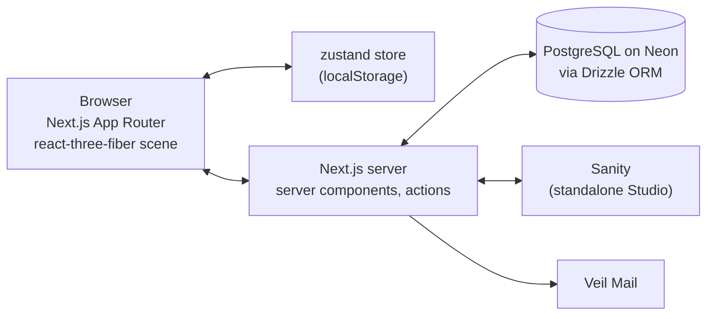

# 01 - System Architecture

## Overview

runWall is a single Next.js application, structured inside a monorepo so that shared packages can be added later. It has three concerns:

1. **Taxonomy**: the user-defined set of item types, each with a name and a colour.
2. **Bricks**: one record per completed item, referencing an item type.
3. **Wall**: the interactive 3D rendering of all placed bricks.

## Components

| Component | Technology | Location |
|-----------|-----------|----------|
| Web app | Next.js (App Router), React, TypeScript, Tailwind CSS | `apps/runWallApp` |
| 3D scene | three.js, @react-three/fiber, @react-three/drei | `apps/runWallApp/src/components/wall` |
| Client state | zustand, persisted to localStorage | `apps/runWallApp/src/store` |
| Validation | zod schemas shared by client and server | `apps/runWallApp/src/lib/schemas.ts` |
| Database | PostgreSQL on Neon, Drizzle ORM over the Neon HTTP driver | `apps/runWallApp/src/db` |
| Content | Sanity, Live Content API via `next-sanity` | `apps/runWallApp/src/sanity` |
| Email | Veil Mail transactional email | `apps/runWallApp/src/lib/email.ts` |

## Data Flow

- The wall is **local-first**. Brick types and bricks live in the zustand store and survive reloads through localStorage.
- Server persistence through Drizzle and Neon is scaffolded but not yet wired to the store. The Drizzle schema mirrors the zod schemas.
- Sanity is reserved for editorial content (copy, guidance, imagery), not for user data.
- Email is server-only and initialised lazily, so the app runs without credentials.

## Rendering Rules

- The 3D canvas is client-only and loaded with `next/dynamic` and `ssr: false` from a client component.
- Pointer events are captured on a wrapper element rather than the canvas so HTML overlays do not block camera movement.
- Every asset-loading component sits inside a Suspense boundary inside the Canvas. See [decisions/2026-09-23-suspense-inside-canvas.md](./decisions/2026-09-23-suspense-inside-canvas.md).

## Technology Choices

Significant choices are recorded in [decisions/](./decisions/README.md) and summarised in the Key Decisions table of the [executive summary](./00-executive-summary.md).
